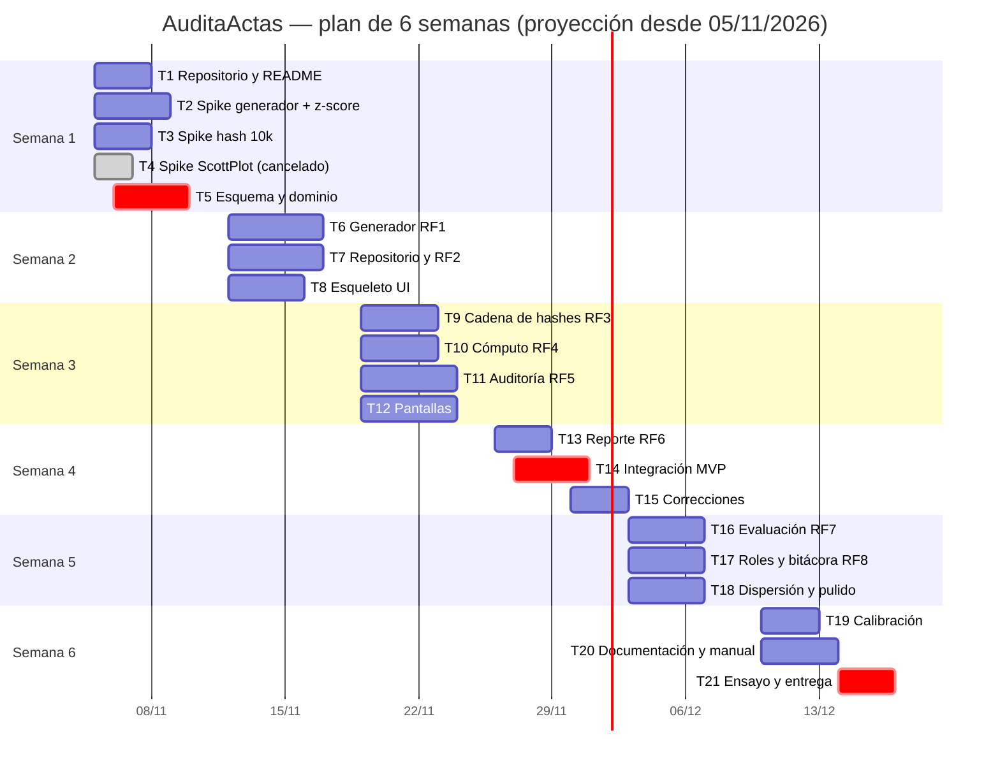

# 4. Plan de desarrollo, tareas y Gantt

## 4.1 Supuestos del plan

- **Equipo:** 3 integrantes (Alex, Nelson, Cristian).
- **Inicio declarado:** 5 de noviembre de 2026. **Al 19 de noviembre** han transcurrido dos semanas.
- **Duración planificada:** 6 semanas (hasta el 16 de diciembre de 2026). La **fecha de entrega/defensa no está
  confirmada**; el plan es una proyección, no un compromiso del docente.
- **Dedicación:** 153 horas totales ≈ **51 h por persona** en 6 semanas (~8,5 h/semana). Es realista para un
  curso con otras materias.
- **Plan vs. avance real:** las columnas *Periodo* y el Gantt son la **proyección original** (no fechas en que se
  terminó cada tarea). El avance real se mide solo por entregable y prueba: al 19 de noviembre el MVP (RF1–RF6)
  ya compila y pasa 47 pruebas, y RF7/RF8 se **adelantaron** respecto a la proyección. Por eso varias tareas con
  periodo futuro figuran como "Hecho (adelantado)": el equipo está por delante del plan, no lo está maquillando.
  El historial de commits del repositorio es la fuente de verdad de *cuándo* se hizo cada cosa.

## 4.2 Equipo, responsabilidades y suplentes

| Código | Integrante | Responsabilidad principal | Entregables verificables | Suplente |
|---|---|---|---|---|
| A | **Alex Cristhian Vásquez Pérez** | Coordinación, arquitectura, integración, persistencia y cadena de hashes (RF2–RF4) | `ActaRepositorio`, `CadenaHashService`, `ComputoService`, integración, PR review | Nelson |
| B | **Nelson Alejandro Zapata Jiménez** | Datos, simulación y estadística (RF1, RF5, RF7) | `GeneradorService`, `Estadistica`, `AuditoriaService`, `EvaluacionService`, calibración | Alex |
| C | **Cristián García Bustamante** | Interfaz, reportes y calidad/pruebas (RF6, RF8 en UI) | `FormPrincipal`, `FormActa`, `FormBitacora`, `ReporteCsv`, suite de pruebas | Nelson |

**Regla de suplencia:** A↔B, B↔C, C↔A. Si alguien falta, su suplente continúa el módulo con la documentación
y las pruebas como contrato. Ningún módulo depende de conocimiento no escrito.

## 4.3 Tareas (21) con responsable, horas y dependencias

| Periodo (proyección) | ID | Tarea concreta | Resp. | Horas | Depende de | Estado al 19/11 | Evidencia |
|---|---|---|---:|---:|---|---|---|
| 05–11 nov | T1 | Repositorio, solución, `Directory.Build.props` y README | Alex | 3 | — | Hecho | `AuditaActas.sln`, README |
| 05–11 nov | T2 | Spike: generador multinomial + z-score en consola | Nelson | 6 | T1 | Hecho | `GeneradorService`, `AuditoriaService`, `GeneradorTests` |
| 05–11 nov | T3 | Spike: hash encadenado con 10.000 registros | Alex | 4 | T1 | Hecho | Evidencias §3 (hash 10.000 en 26 ms) |
| 05–11 nov | T4 | Spike: gráfico ScottPlot en WinForms | Cristian | 3 | T1 | **Cancelado** (T8 ya no depende de él): gráfico postergado (T18) | Decisión §3.6 (gráfico postergado) |
| 05–11 nov | T5 | Esquema SQLite y modelo de dominio (congelado) | Alex | 5 | T1 | Hecho | `ActaRepositorio.Esquema`, `Acta.cs` |
| 12–18 nov | T6 | Generador de datos RF1 | Nelson | 10 | T2, T5 | Hecho | `GeneradorService`, 3 pruebas |
| 12–18 nov | T7 | Repositorio, validaciones y alta/importación RF2 | Alex | 10 | T5 | Hecho | `Acta.Validar`, `ActaCsv`, `RegistroService` |
| 12–18 nov | T8 | Esqueleto de UI y navegación | Cristian | 8 | T5 | Hecho (sin gráfico) | `FormPrincipal` |
| 19–25 nov | T9 | Cadena de hashes y verificación RF3 | Alex | 8 | T7 | Hecho | `CadenaHashService`, 6 pruebas |
| 19–25 nov | T10 | Cómputo por niveles RF4 | Alex | 8 | T7 | Hecho | `ComputoService`, 2 pruebas |
| 19–25 nov | T11 | Auditoría z-score RF5 | Nelson | 10 | T6, T10 | Hecho | `AuditoriaService`, 5 pruebas |
| 19–25 nov | T12 | Pantallas de carga, verificación y resultados | Cristian | 10 | T8, T9, T10 | Hecho | `FormPrincipal` (generar/importar/verificar/resultados) |
| 26 nov–02 dic | T13 | Reporte CSV de sospechosas RF6 | Cristian | 6 | T11 | Hecho | `ReporteCsv` + CSV de evidencias |
| 26 nov–02 dic | T14 | **Integración MVP** y pruebas de aceptación | Todos | 10 | T9–T13 | Hecho | `dotnet test` (47), evidencias |
| 26 nov–02 dic | T15 | Corrección de errores del MVP | Todos | 8 | T14 | Hecho | Build 0 advertencias, pruebas en verde |
| 03–09 dic | T16 | Evaluación del detector RF7 | Nelson | 8 | T14 | Hecho (adelantado) | `EvaluacionService`, pantalla, 3 pruebas |
| 03–09 dic | T17 | Roles y bitácora RF8 | Alex | 8 | T14 | Hecho (adelantado) | `Permisos`, `BitacoraService`, 7 pruebas |
| 03–09 dic | T18 | Gráfico de dispersión y pulido de UI | Cristian | 8 | T14 | **No comprometido** (decisión: fuera del alcance; se retoma solo si sobra tiempo) | Decisión §3.6 y backlog §7.7 |
| 10–16 dic | T19 | Calibración de umbrales y análisis de resultados | Nelson | 6 | T16 | Hecho (barrido 2,0–4,0 documentado) | Evidencias §2 |
| 10–16 dic | T20 | Documentación final y manual de usuario | Alex | 8 | T14 | Hecho | Docs 01–11, README, manual |
| 10–16 dic | T21 | Ensayo de la demo y entrega | Todos | 6 | T15–T20 | **En curso** | Guion de demo |
| | | **Total** | | **153 h** | | | |

**Horas del MVP (T1–T15):** 109 h. **Post-MVP (T16–T21):** 44 h.

### Estimaciones: de dónde salen

- T2/T3/T4/T5 son spikes de 3–6 h para reducir incertidumbre antes de comprometer el resto.
- Las tareas de implementación se estimaron por tamaño de archivo y complejidad: un servicio mediano con
  pruebas ≈ 8–10 h; una pantalla ≈ 8–10 h; integración y corrección ≈ 18 h.
- La estimación se contrasta con el trabajo real: el MVP está compilando y con 47 pruebas, por lo que las
  horas del camino crítico no están subestimadas de forma evidente.
- Si una tarea se desvía > 30 %, se ajusta el alcance (ver §4.6), no la fecha de entrega.

## 4.4 Gantt (proyección)



## 4.5 Dependencias y camino crítico

```
T1 → T5 → T7 → T9 ─┐
        └→ T10 ────┼→ T14 → T15 → T21
T2 → T6 → T11 ─────┘
T5 → T8 → T12 ─────┘
T13 ───────────────┘
```

- **Camino crítico:** T5 (esquema) → T7 (repositorio/validaciones) → T9/T10 (hash/cómputo) → T14 (integración)
  → T21 (ensayo).
- **Tareas que bloquean al resto:** T5, T7 y T14. T5 se cierra y congela en la semana 1; si cambia el esquema
  después, se paga dos veces (repositorio y pruebas).
- **Dependencias externas que no bloquean:** confirmación del docente sobre formato y fecha. El producto se
  puede entregar como repositorio + demo + documentación; si el docente pide otra cosa, se adapta la entrega,
  no el núcleo.
- **Ruta de emergencia:** si T9/T10 se atrasan, T13 se puede adelantar con datos en memoria; si T14 se atrasa,
  se recorta T18 y se mantiene el flujo mínimo.

## 4.6 Si hay que reducir un 40 %

Se conserva el núcleo que resuelve el problema: **RF1 + RF2 + RF3 + RF4 + RF5 + RF6** (109 h → ~65 h). Se
elimina, en orden:

1. RF8 (roles/bitácora) y se trabaja con un usuario único.
2. Pantalla RF7 y se dejan las métricas en el reporte de evidencias.
3. T18 (dispersión) y chi-cuadrado (no planificado).
4. Persistencia SQLite; se trabaja en memoria y CSV.

**No se recorta:** la cadena de hashes, las validaciones, el cómputo ni el reporte. Sin ellos el proyecto no
resuelve el problema, solo sería una tabla bonita.

## 4.7 Hitos de aceptación

| Hito | Fecha objetivo | Criterio |
|---|---|---|
| M1 — Esquema y dominio congelados | 11 nov | `dotnet build` y pruebas de `Acta` en verde |
| M2 — Datos y auditoría funcionando | 18 nov | Dataset semilla 42 reproducible y métricas calculadas |
| M3 — MVP integrado | 02 dic | Flujo completo generar→verificar→auditar→exportar |
| M4 — Post-MVP y calidad | 09 dic | RF7/RF8 + 47 pruebas + 0 advertencias |
| M5 — Entrega | 16 dic (proyección) | Demo de 8 min + README reproducible + evidencia |

## 4.8 Riesgos de cronograma y control

| Riesgo | Señal temprana | Control |
|---|---|---|
| Una tarea se estira | Queda abierta > 2 días sin PR | Reunión de 15 min, se divide o se recorta |
| Integración tardía | Ramas divergen > 3 días | Integración parcial desde la semana 2; `main` verde |
| Dependencia de una persona | Un módulo sin suplente | Suplencia A↔B, B↔C, C↔A; PR cruzado |
| Entorno del docente | No puede ejecutar | README probado en máquina limpia; evidencia en consola |

El detalle de riesgos está en [`05-riesgos.md`](05-riesgos.md).
